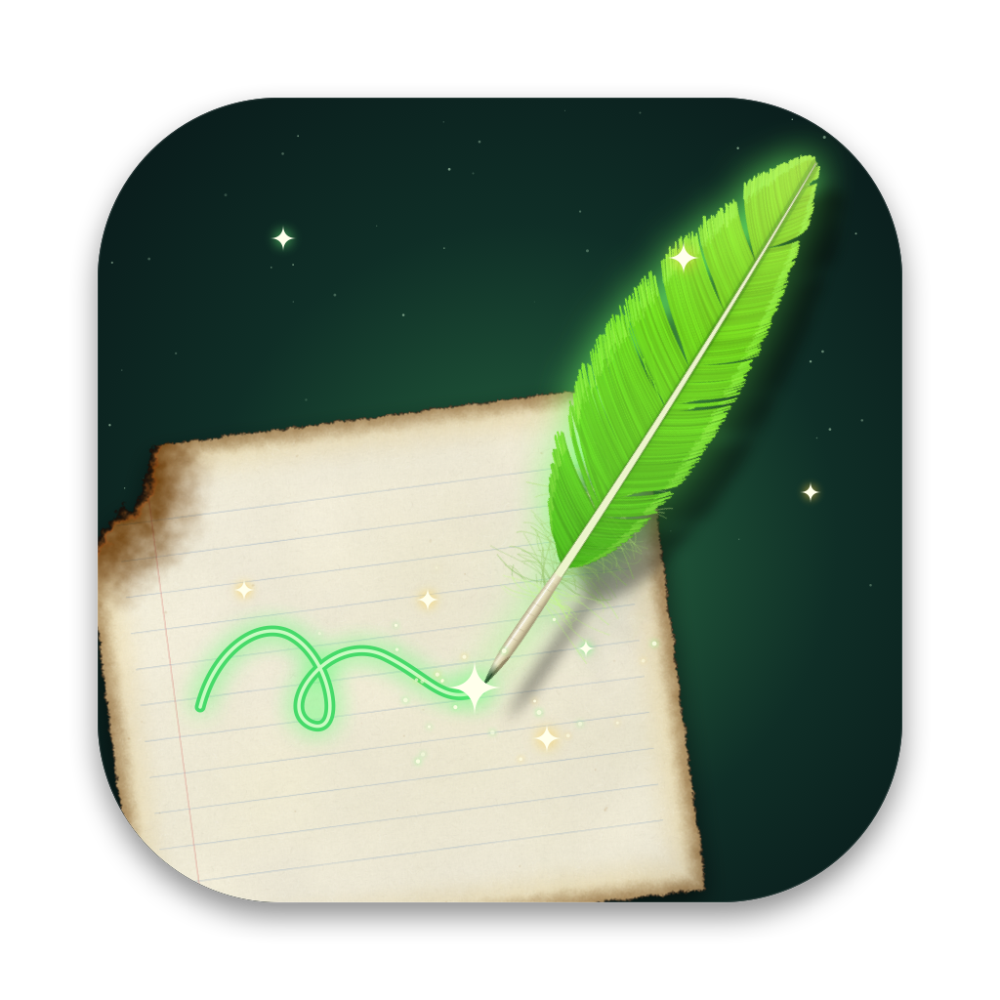

<p align="center"></p>

<h1 align="center">Scribblio</h1>

<p align="center">A magic quill for your Mac desktop.</p>

A sheet of old, burnt-edged paper floats down onto your desktop with an acid-green quill hovering over it, Rita Skeeter style. Start typing and the quill writes every letter for you in cursive, in ink that glows green and then dries dark. The paper behaves like a real sheet: lift a corner, curl it, fold it, flip it, and it springs back flat. Write in English or Arabic, keep many notes on the desktop, and save them to open again later.

- macOS 14 Sonoma or later
- Apple silicon and Intel Macs
- Needs no permissions: no Accessibility, no Documents access, no network

## Install

Pick whichever way you like. They all put the same Scribblio in your Applications folder.

| Way | Terminal? | You need |
| --- | --- | --- |
| [A. Disk image](#a-disk-image-dmg) | No | `Scribblio.dmg` |
| [B. Installer package](#b-installer-package-pkg) | No | `Scribblio.pkg` |
| [C. Install the .dmg or .pkg from Terminal](#c-install-the-dmg-or-pkg-from-terminal) | Yes | `Scribblio.dmg` or `Scribblio.pkg` |
| [D. Build from source](#d-build-from-source) | Yes | The source code from this repository |

**Where to get the installers:** download `Scribblio.dmg` or `Scribblio.pkg` from the [latest release](https://github.com/FadyWaheed11/Scribblio/releases/latest). If there is no release yet, or you want to build them yourself, follow [Make the installers](#make-the-installers).

### A. Disk image (.dmg)

1. Double-click **Scribblio.dmg**. A window opens with **Scribblio** and an **Applications** folder.
2. Drag **Scribblio** onto **Applications**.
3. Eject the disk image (click the ⏏ next to "Scribblio" in the Finder sidebar).
4. Open Scribblio from Launchpad or Spotlight (⌘Space, type "Scribblio").

### B. Installer package (.pkg)

1. Double-click **Scribblio.pkg**.
2. Click **Continue**, then **Install**, and enter your Mac password.
3. Click **Close**. Scribblio is now in Applications.
4. Open Scribblio from Launchpad or Spotlight (⌘Space, type "Scribblio").

### The first time you open it (A and B)

Scribblio is not notarized by Apple, so the first time macOS may say it could not verify the app (with the .pkg, this appears when you open the installer).

1. Click **Done**.
2. Open **System Settings > Privacy & Security** and scroll down to the message about Scribblio.
3. Click **Open Anyway** and confirm with your password.

You only do this once. After that Scribblio opens normally.

### C. Install the .dmg or .pkg from Terminal

Open **Terminal** (⌘Space, type "Terminal"). These commands assume the file is in your Downloads folder; change the path if it is somewhere else.

**From Scribblio.pkg:**

```bash
sudo installer -pkg ~/Downloads/Scribblio.pkg -target /
open /Applications/Scribblio.app
```

`sudo` asks for your Mac password (nothing shows while you type it, that is normal).

**From Scribblio.dmg:**

```bash
hdiutil attach ~/Downloads/Scribblio.dmg -nobrowse -mountpoint /tmp/scribblio
cp -R /tmp/scribblio/Scribblio.app /Applications/
hdiutil detach /tmp/scribblio
xattr -dr com.apple.quarantine /Applications/Scribblio.app
open /Applications/Scribblio.app
```

The `xattr` line removes the "downloaded from the internet" flag, so macOS opens Scribblio without the first-launch check.

### D. Build from source

Scribblio builds from source in a couple of minutes. It needs no Xcode project, only Apple's free Command Line Tools.

1. **Install the Command Line Tools.** In Terminal run the command below, click **Install** in the window that appears and wait. If it says they are already installed, go on.

   ```bash
   xcode-select --install
   ```

2. **Get the source code** and go into its folder. With git:

   ```bash
   git clone https://github.com/FadyWaheed11/Scribblio.git
   cd Scribblio
   ```

   Without git: on the [repository page](https://github.com/FadyWaheed11/Scribblio) click **Code > Download ZIP**, double-click the zip to unzip it, then in Terminal type `cd ` (with a space) and drag the unzipped folder from Finder into the Terminal window and press Return.

3. **Build the app.** When it prints `built build/Scribblio.app`, it is ready.

   ```bash
   zsh build.sh
   ```

4. **Move it to Applications and open it.**

   ```bash
   cp -R build/Scribblio.app /Applications/
   xattr -cr /Applications/Scribblio.app
   open /Applications/Scribblio.app
   ```

   The `xattr` line clears the "downloaded from the internet" flag; without it macOS may close the app as soon as it opens, because the code came from a download. Always open the copy in Applications, not the one in the `build` folder. If you can't write to `/Applications`, use your own Applications folder: run `mkdir -p ~/Applications` and replace `/Applications` with `~/Applications` in the commands.

### After installing

A sheet of paper drops onto your desktop. Click it once and start typing. To keep Scribblio handy, right-click its Dock icon and choose **Options > Keep in Dock**.

## Make the installers

To share Scribblio, build the ready-to-install files once on your Mac (after steps 1 and 2 of [D. Build from source](#d-build-from-source)):

```bash
zsh package.sh
```

It makes two files in the `dist` folder, both for Apple silicon and Intel Macs:

| File | How people install it |
| --- | --- |
| `dist/Scribblio.dmg` | Double-click, drag Scribblio into Applications |
| `dist/Scribblio.pkg` | Double-click, click through the installer |

Send either file (AirDrop, email, a download link). People install it with [A](#a-disk-image-dmg), [B](#b-installer-package-pkg) or [C](#c-install-the-dmg-or-pkg-from-terminal).

`zsh release.sh` makes a plain `dist/Scribblio.zip` instead, if you prefer a zip.

#### No warning on first launch

To make Scribblio open with no Gatekeeper warning at all, it has to be signed with an Apple Developer ID and notarized by Apple. That needs a paid [Apple Developer Program](https://developer.apple.com/programs/) membership. Once you have it:

1. In Xcode, under **Settings > Accounts**, create a **Developer ID Application** and a **Developer ID Installer** certificate.
2. Save your notarization login once (use an [app-specific password](https://support.apple.com/102654)):

   ```bash
   xcrun notarytool store-credentials scribblio --apple-id you@example.com --team-id TEAMID
   ```

3. Build signed and notarized installers:

   ```bash
   SCRIBBLIO_SIGN="Developer ID Application: Your Name (TEAMID)" \
   SCRIBBLIO_INSTALLER_SIGN="Developer ID Installer: Your Name (TEAMID)" \
   SCRIBBLIO_NOTARY_PROFILE=scribblio \
   zsh package.sh
   ```

## Update

Quit Scribblio first (⌘Q; it reminds you to save unsaved notes). Then install the new version the same way you installed it:

- **Disk image or installer package (A, B, C):** install the new `Scribblio.dmg` or `Scribblio.pkg` again. With the disk image, choose **Replace** when Finder asks.
- **Built from source (D):** in the project folder, get the latest code and build again (if you downloaded a zip instead of using git, download the new zip and use its folder instead of `git pull`):

  ```bash
  git pull
  zsh build.sh
  rm -rf /Applications/Scribblio.app
  cp -R build/Scribblio.app /Applications/
  xattr -cr /Applications/Scribblio.app
  open /Applications/Scribblio.app
  ```

Your notes and settings are kept.

## Uninstall

Quit Scribblio (⌘Q). Open **Finder**, press **⇧⌘A** to go to **Applications**, drag **Scribblio** to the **Trash** and empty the Trash. If Finder asks for your Mac password, enter it.

Delete it from Finder: Launchpad, the Apps screen, Spotlight and the Dock can't uninstall apps that don't come from the App Store, and dragging Scribblio's Dock icon only removes it from the Dock.

To also remove its settings (recent notes list, note size):

```bash
defaults delete com.fadywaheed.scribblio
```

If you installed with the installer package, you can also remove its install record:

```bash
sudo pkgutil --forget com.fadywaheed.scribblio.pkg
```

Your saved notes are not removed; they stay wherever you saved them until you delete them yourself.

## Using Scribblio

### Writing

- Type, and the quill writes it. Fresh ink glows green and dries dark within a second.
- Return starts a new line. Delete erases the letter before the quill and it melts away in green light; Forward Delete erases the letter after it.
- When a note is longer than the page, the lines scroll smoothly up the paper. Nothing is lost; move up with the arrows to bring earlier lines back.
- Outside the paper, every click goes straight to your desktop. Click the paper to give it the keyboard again.

### Moving the quill

- The quill is the cursor. Arrow keys move it: left and right by letter, up and down by line.
- With Option, the arrows jump by word. With Command, they go to the start or end of the line (left and right) or of the whole note (up and down). Home and End work too.
- Click any letter on the paper to put the quill there, then type or delete in the middle of your text.

### The paper

- Grab any edge to lift the paper, curl it, fold it over or flip it. Let go and it springs back flat.
- Drag a corner to resize the note (the cursor turns into resize arrows over a corner). The opposite corner stays put and the writing scales with the paper.
- Scroll over a note to rotate it. Right-click it for a menu with every command.

### Notes and files

- ⌘N drops another sheet, so you can keep many notes on the desktop. Click a note to bring it to the top; the quill always writes on the top one. Notes stack and cast shadows on each other.
- ⌘S saves the note as a `.scribblio` file, wherever you choose. The save window starts in the folder you used last.
- ⌘O opens notes, several at once if you like, and **File > Open Recent** lists the latest ones. Double-clicking a note in Finder opens it as well. When a note opens, the quill writes it out again.
- The note's size is saved with it, and new notes start at the last size you picked.
- ⌘W closes the top note and asks to save if needed.

### Keyboard shortcuts

| Shortcut | Action |
| --- | --- |
| ⌘N | New note |
| ⌘O | Open notes |
| ⌘S / ⌘⇧S | Save / Save As |
| ⌘W | Close the top note |
| ⌘Z / ⌘⇧Z | Undo / Redo (each note has its own history) |
| ⌘A | Select all text (green highlighter); then type or Delete to replace it |
| ⌘C / ⌘X / ⌘V | Copy / Cut / Paste |
| ⌘⌫ | Clear the page |
| Esc | Remove the highlight |
| Arrows, ⌥ Arrows, ⌘ Arrows | Move the quill by letter or line, by word, to the ends |
| ⌘Q | Quit |

## Arabic and other languages

- Arabic writing works out of the box. Switch your keyboard to Arabic (⌃Space) and the quill moves to the right edge; it writes from right to left in a handwritten Naskh and leans the other way. Arabic and English can be mixed in one line, and the arrow keys follow what you see on screen.
- The app itself (menus and dialogs) is in English and Arabic and follows your Mac's language. To use Arabic just for Scribblio: **System Settings > General > Language & Region > Applications**, add Scribblio and choose **العربية**.
- To add another language, copy `Localization/ar.lproj` to `Localization/<code>.lproj`, translate the strings in both files, and add the language code to `CFBundleLocalizations` in `Info.plist`.

## Privacy

Scribblio asks for no permissions. It reads and writes only the files you pick in its Save and Open windows, keeps a short list of recent notes in its settings, and never connects to the network.

## Project layout

| Path | What it is |
| --- | --- |
| `Sources/main.swift` | The app: the desktop window, notes, files, menus, mouse and keyboard |
| `Sources/Paper.swift` | The page: a small text editor that the quill writes into, with Arabic support |
| `Sources/Quill.swift` | The quill, its sparkles and the art it is drawn with |
| `Sources/Cloth.swift`, `Sources/SpatialHash.swift` | The paper physics |
| `Sources/Renderer.swift`, `Sources/Shaders.swift` | Metal rendering of the sheets and their shadows |
| `Sources/Strings.swift`, `Localization/` | Interface text in English and Arabic |
| `Resources/` | The paper texture and the app icon |
| `tools/note.swift`, `tools/icon.swift` | Generators for the paper texture and the icon |
| `build.sh` | Builds the app |
| `package.sh`, `release.sh` | Build the installers (.dmg and .pkg), or a plain zip, for sharing |

To regenerate the paper texture or the icon after changing their generators:

```bash
swiftc -O tools/note.swift -o /tmp/note && /tmp/note Resources/paper.png
cp tools/icon.swift /tmp/main.swift && swiftc -O /tmp/main.swift Sources/Quill.swift -o /tmp/icon && /tmp/icon
```

## License

MIT, see [LICENSE](LICENSE).
